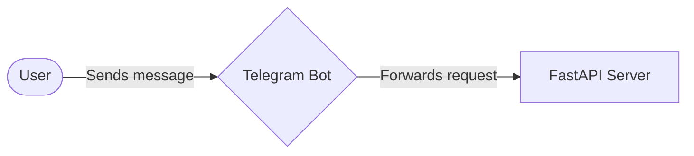
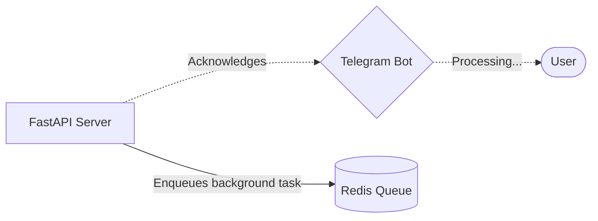
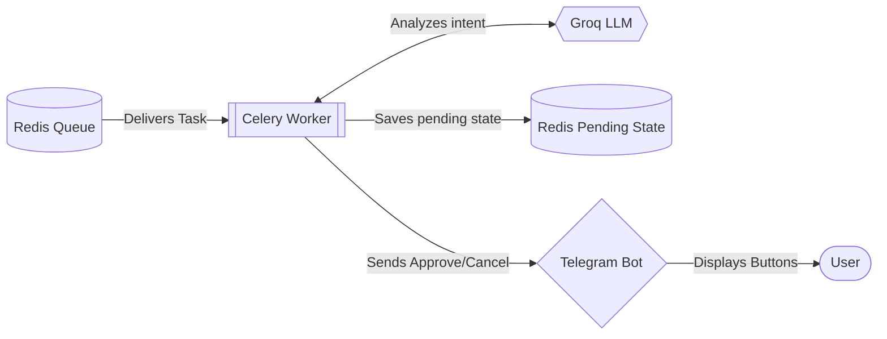
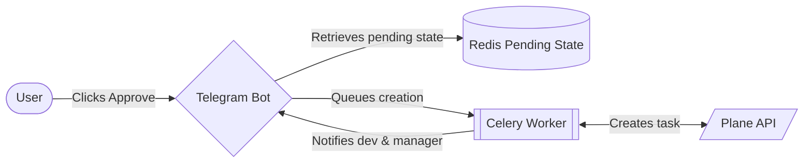

# Project Workflow

> [!NOTE]
> This interactive walkthrough illustrates how data moves through the AI Task Management system—from the moment a user sends a message, through the AI and background queues, and finally back to the user.

````carousel
## 1. Initial Request
> [!IMPORTANT]
> The user interacts with the system via Telegram. The bot immediately forwards the request to the backend API.



<!-- slide -->
## 2. Acknowledgment & Queuing
> [!TIP]
> The server quickly responds to the bot to prevent timeouts, and safely enqueues the heavy lifting into Redis.



<!-- slide -->
## 3. AI Extraction & Approval
> [!NOTE]
> Celery uses Groq LLM to extract task details, stores them in Redis temporarily, and asks the Manager for approval via Telegram buttons.



<!-- slide -->
## 4. Task Creation & Feedback
> [!TIP]
> If the manager approves, the bot retrieves the pending state, queues task creation in Plane, and notifies both the manager and assigned developer.


````
